<div align="center">

# 🛒 E-commerce Customer Churn Analytics

**An end-to-end analytics and machine learning project: from raw data to SQL insights, a churn prediction model, and interactive dashboards.**

[](https://www.python.org/)
[](https://www.postgresql.org/)
[](https://scikit-learn.org/)
[](https://xgboost.ai/)
[](https://ecommerce-churn-analytics.streamlit.app)
[](tableau/dashboard_build_guide.md)
[](LICENSE)

### [🚀 Live interactive dashboard](https://ecommerce-churn-analytics.streamlit.app)

</div>

---

## 📌 Overview

An Indian online retailer is growing fast (**+94% revenue YoY**), but almost **half of its active customers stop
buying within 90 days**. This project answers three business questions:

1. **Who** is likely to churn in the next 90 days?
2. **Why** do they churn? Which experiences and behaviours drive it?
3. **How much revenue** is at risk, and where should the retention budget go?

It covers the full analyst workflow: **data generation → PostgreSQL warehouse → SQL analysis → feature engineering
in SQL → ML modelling and explainability → BI dashboards → deployed web app**.

### Highlights

| | |
|---|---|
| 🗄️ **Data** | 6 relational tables, ~330k rows (customers, products, orders, order items, support tickets, web sessions) |
| 🧮 **SQL** | CTEs, window functions (`LAG`, `NTILE`, `RANK`, running totals, moving averages), cohort retention, RFM segmentation, a leakage-safe feature view |
| 🤖 **ML** | Logistic Regression vs Random Forest vs XGBoost · **ROC-AUC 0.86** · top-decile lift **2.3×** · SHAP explanations |
| 📊 **BI** | Streamlit web app (deployed) + Tableau Public dashboard (build guide included) |
| 💰 **Impact** | **₹5.5 Cr** of revenue at risk quantified; 2,252 high-risk customers identified with each one's top churn driver |

---

## 🏗️ Architecture

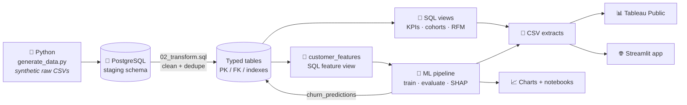

## 🧰 Tech Stack

| Layer | Tools |
|---|---|
| Language | Python 3.13 (pandas, NumPy, Faker) |
| Database | PostgreSQL 17, SQLAlchemy, psycopg 3 |
| Machine learning | scikit-learn, XGBoost, SHAP |
| Visualisation | Matplotlib, Seaborn, Plotly |
| BI / app | Streamlit (Community Cloud), Tableau Public |
| Workflow | Make, Jupyter, Git / GitHub |

---

## 🗄️ Data Model

Synthetic but realistic: customers are simulated month by month, and **bad experiences (late deliveries, returns,
unhappy support tickets) build up a hidden "frustration" score** that raises their chance of disengaging and churning.
The model never sees this hidden state; it has to infer churn from observable behaviour, just as in a real business.
Real-world data issues (duplicates, missing values, messy emails) are injected on purpose and cleaned in SQL.

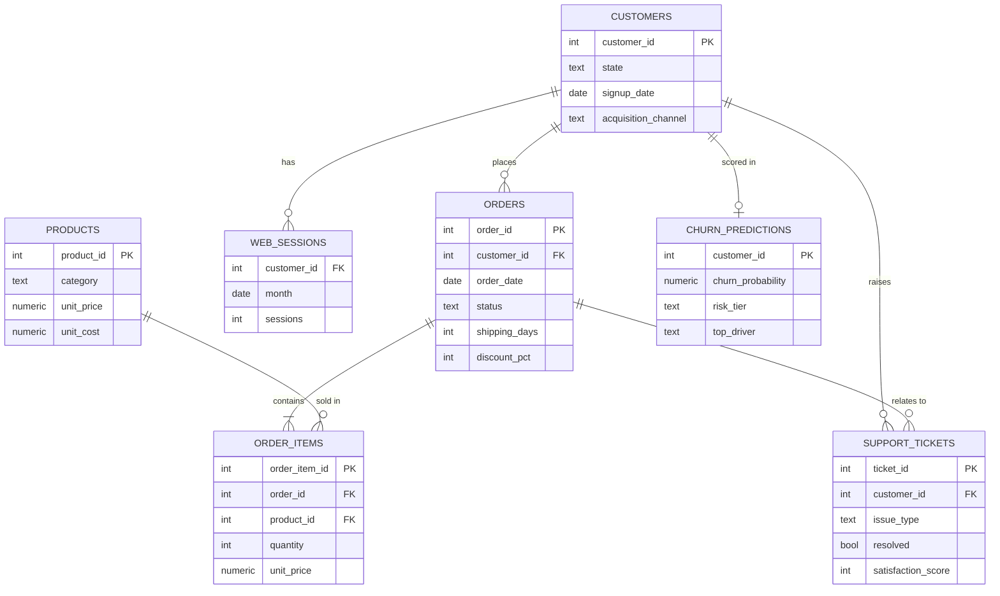

| Table | Rows | Data-quality issues found and fixed |
|---|---:|---|
| customers | 10,000 | 60 duplicate rows, 301 messy emails, 120 missing ages, 60 missing cities |
| orders | 74,060 | 120 duplicate rows, 222 missing delivery times |
| order_items | 125,210 | – |
| support_tickets | 7,361 | – |
| web_sessions | 111,764 | – |
| products | 500 | – |

---

## 🧮 SQL Highlights

All SQL lives in [`sql/`](sql/). Integrity checks (orphan keys, orders before signup, out-of-range dates) all return 0
after cleaning.

<details>
<summary><b>RFM segmentation with <code>NTILE</code> window functions</b></summary>

```sql
WITH base AS (
    SELECT customer_id,
           (SELECT MAX(order_date) FROM orders) - MAX(order_date) AS recency_days,
           COUNT(*)                                               AS frequency,
           SUM(order_value)                                       AS monetary
    FROM   v_orders
    WHERE  status = 'Delivered'
    GROUP  BY customer_id
), scored AS (
    SELECT b.*,
           NTILE(5) OVER (ORDER BY recency_days DESC) AS r_score,
           NTILE(5) OVER (ORDER BY frequency)         AS f_score,
           NTILE(5) OVER (ORDER BY monetary)          AS m_score
    FROM   base b
)
SELECT customer_id, r_score, f_score, m_score,
       CASE WHEN r_score >= 4 AND f_score >= 4 THEN 'Champions'
            WHEN r_score >= 3 AND f_score >= 3 THEN 'Loyal'
            WHEN r_score <= 2 AND f_score >= 3 THEN 'At Risk'
            ...
       END AS rfm_segment
FROM   scored;
```
</details>

<details>
<summary><b>Leakage-safe feature engineering: a single SQL view, parameterised by snapshot date</b></summary>

`customer_features` builds 29 features per customer **only from data on or before the snapshot date** (recency,
frequency, monetary, order trend, return rate, delivery speed, late-delivery rate, support satisfaction, web
engagement…), plus the label: *no order in the following 90 days*. The snapshot date is read from a one-row
parameter table, so the **same view** produces training data (30 Jun 2026, label known) and scoring data
(30 Sep 2026, today).

```sql
COUNT(*) FILTER (WHERE h.status <> 'Cancelled' AND h.order_date >  p.snap - 90)  AS orders_last_90d,
COUNT(*) FILTER (WHERE h.status <> 'Cancelled' AND h.order_date >  p.snap - 180
                                               AND h.order_date <= p.snap - 90)  AS orders_prev_90d,
AVG((h.shipping_days > 7)::INT) FILTER (WHERE h.order_date > p.snap - 365)       AS late_delivery_rate,
```
</details>

| File | Purpose |
|---|---|
| [`01_schema.sql`](sql/01_schema.sql) | Tables, constraints, indexes, revenue views |
| [`02_transform.sql`](sql/02_transform.sql) | Staging → clean typed tables (dedupe, normalise, cast) |
| [`03_data_quality.sql`](sql/03_data_quality.sql) | Raw vs clean row counts, issue counts, integrity checks |
| [`04_analysis_views.sql`](sql/04_analysis_views.sql) | Monthly KPIs (MoM %, running total, 3-month moving average), cohort retention, RFM |
| [`05_features.sql`](sql/05_features.sql) | ML feature view + churn label |
| [`06_business_questions.sql`](sql/06_business_questions.sql) | 10 business questions: YoY growth, Pareto, category ranking, channel quality, delivery vs churn… |

---

## 🔍 Key Insights

<p align="center">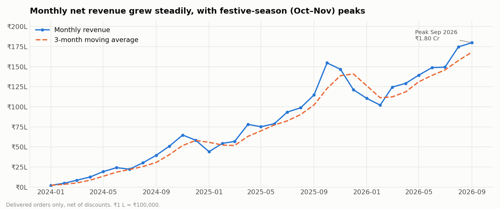</p>

<p align="center">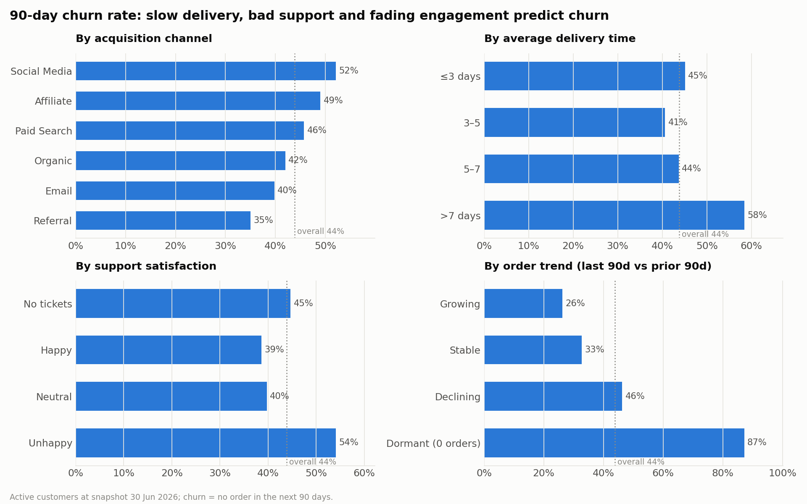</p>

1. **Revenue is concentrated.** The top 20% of customers generate **70%** of revenue, and Electronics alone is **63%**.
2. **Slow delivery drives churn.** Customers averaging more than 7 delivery days churn at **58%**, against 41–45% otherwise.
   Assam, Bihar and Odisha have **36–61%** late deliveries and the highest predicted churn.
3. **Unhappy support tickets** raise churn to **54%**, against 39% for satisfied customers.
4. **Channel quality varies.** Referral customers churn at **35%**, Social Media customers at **52%**.
5. **Engagement is the earliest warning sign.** Customers with growing order frequency churn at only **26%**, while
   dormant ones churn at **87%**.

<p align="center">
  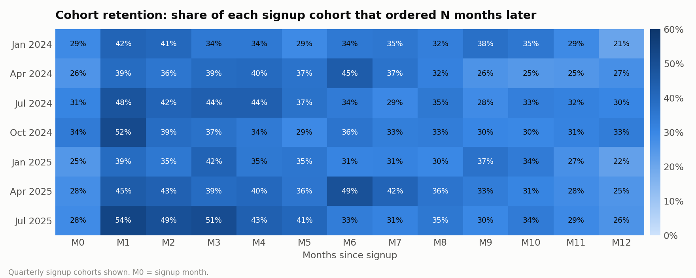
</p>
<p align="center">
  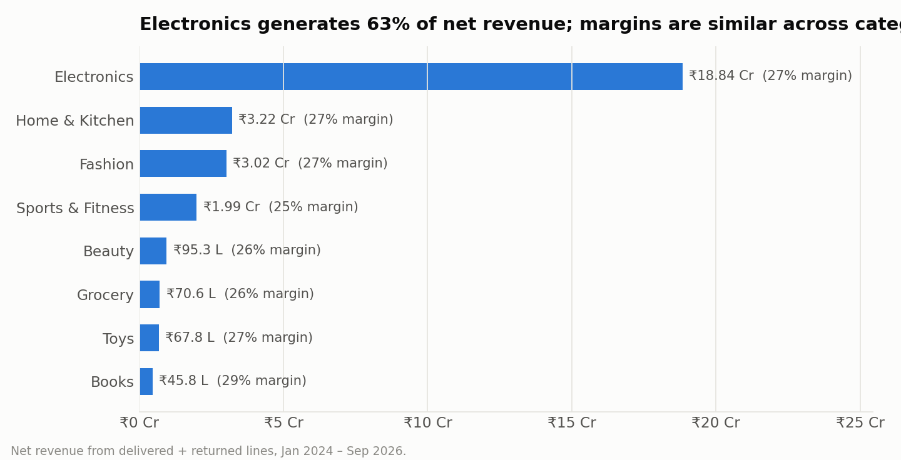
  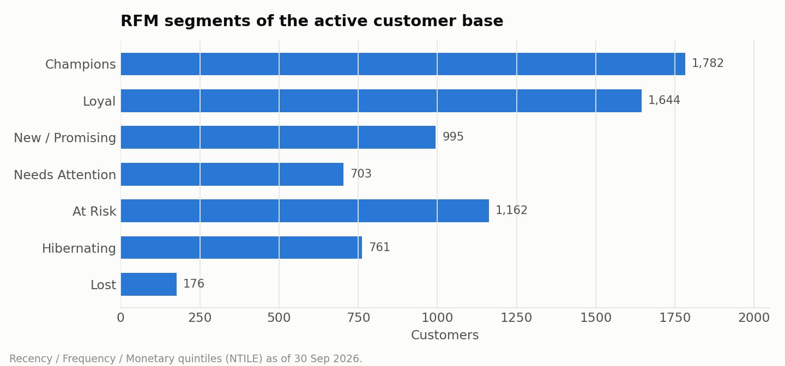
</p>

➡️ Full write-up with recommendations: [`reports/insights.md`](reports/insights.md)

---

## 🤖 Churn Prediction Model

**Setup:** 6,571 customers active at the 30 Jun 2026 snapshot · 43.8% churned in the following 90 days ·
stratified 80/20 split · 5-fold cross-validation · decision threshold chosen on out-of-fold predictions (never on
the test set).

| Model | CV ROC-AUC | Test ROC-AUC | Test PR-AUC |
|---|---:|---:|---:|
| **Random Forest** ✅ | **0.848 ± 0.005** | **0.859** | **0.860** |
| XGBoost | 0.842 ± 0.005 | 0.863 | 0.864 |
| Logistic Regression | 0.840 ± 0.007 | 0.857 | 0.850 |

The model was selected on cross-validated AUC, not on test scores.

| Metric (test set, threshold 0.45) | Value |
|---|---:|
| Precision | 0.74 |
| Recall | 0.75 |
| F1 | 0.75 |
| **Top-decile lift** | **2.28×**: every customer in the riskiest 10% did churn |

<p align="center">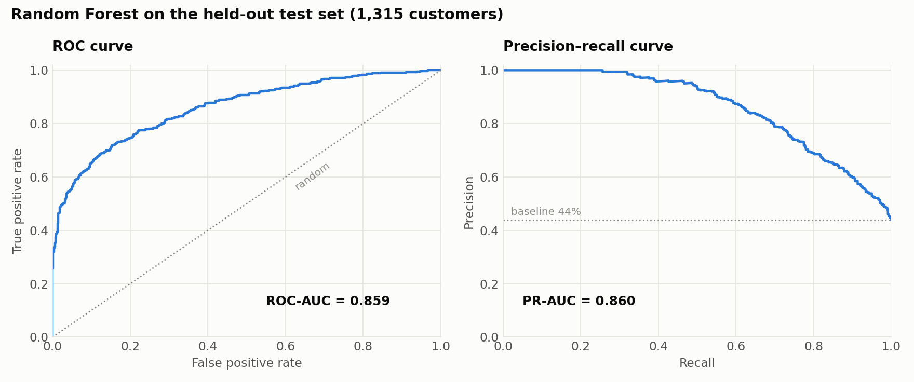</p>
<p align="center">
  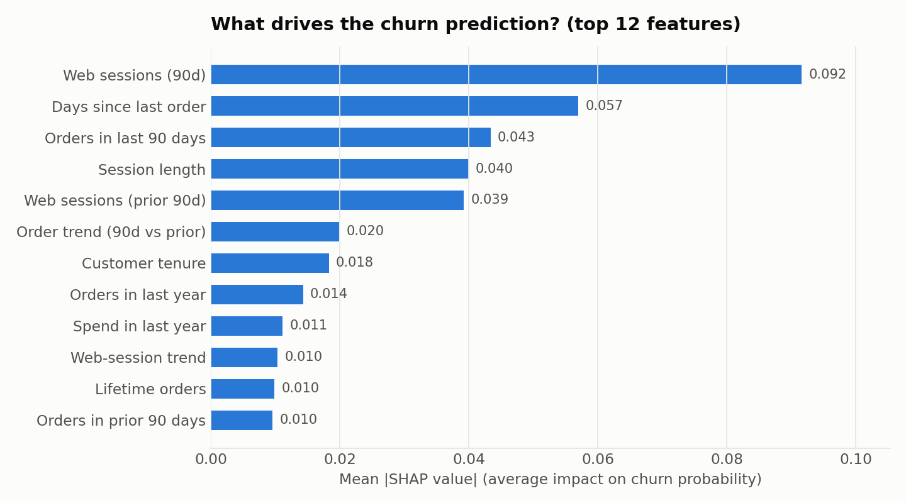
  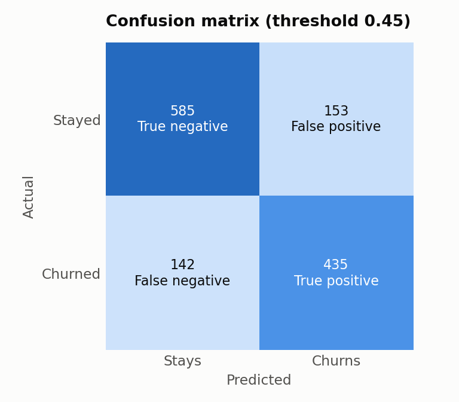
</p>

### Scoring today's customers

The final model scores all **7,346 active customers as of 30 Sep 2026** and writes the results back to PostgreSQL
(`churn_predictions`), each with a churn probability, risk tier and **top personal churn driver** (from SHAP).

<p align="center">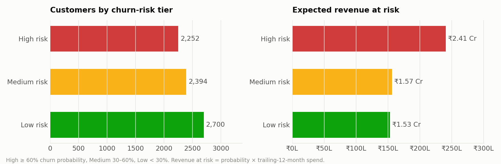</p>

---

## 📊 Dashboards

### Streamlit web app: [ecommerce-churn-analytics.streamlit.app](https://ecommerce-churn-analytics.streamlit.app)

| Tab | What it shows |
|---|---|
| 📈 **Overview** | KPI cards, revenue trend, category mix, delivery speed by state |
| 🔁 **Retention & Segments** | Cohort retention heatmap, RFM segments and their churn risk |
| ⚠️ **Churn Risk** | Filterable at-risk customer list with revenue at risk and top driver, downloadable as CSV for the CRM team |
| 🧪 **What-if Predictor** | Pick a customer, change delivery time, satisfaction or engagement, and see the churn probability update live |
| 🤖 **Model** | Model comparison, metrics, feature importance |

### Tableau Public

Tableau-ready extracts are exported to [`data/exports/`](data/exports/). [`tableau/dashboard_build_guide.md`](tableau/dashboard_build_guide.md)
gives the step-by-step build (relationships, calculated fields, 3 dashboards, colour conventions).

---

## 📁 Project Structure

```
├── app/
│   ├── streamlit_app.py          # deployed interactive dashboard
│   └── requirements.txt          # slim dependencies for Streamlit Cloud
├── data/
│   ├── raw/                      # generated CSVs (git-ignored, reproducible)
│   └── exports/                  # Tableau / app extracts
├── images/                       # charts used in this README
├── models/                       # trained model, metrics, feature importance
├── notebooks/
│   ├── 01_eda.ipynb              # exploratory analysis
│   └── 02_modeling.ipynb         # model evaluation + SHAP
├── reports/insights.md           # findings + recommendations
├── sql/                          # schema, cleaning, data quality, analysis, features
├── src/
│   ├── config.py                 # paths, dates, DB connection
│   ├── generate_data.py          # synthetic data simulator
│   ├── load_to_postgres.py       # COPY to staging → SQL transform → DQ report
│   ├── train_model.py            # train · evaluate · explain · score
│   ├── export_for_tableau.py     # CSV extracts
│   └── make_charts.py            # README charts
├── tableau/dashboard_build_guide.md
├── Makefile                      # one-command pipeline
└── requirements.txt
```

---

## ▶️ Run It Locally

**Prerequisites:** Python 3.11+ and PostgreSQL 14+.

```bash
# 1. Clone
git clone https://github.com/sun-9545sunoj/ecommerce-churn-analytics.git
cd ecommerce-churn-analytics

# 2. PostgreSQL (macOS / Homebrew; on Linux or Windows use your package manager or installer)
brew install postgresql@17 && brew services start postgresql@17
createdb ecommerce
cp .env.example .env            # edit if your DB user / password differ

# 3. Python environment
make setup                      # creates .venv and installs requirements

# 4. Run the full pipeline (~4 min): data → Postgres → model → exports → charts → notebooks
make all

# 5. Explore
make sql                        # run the 10 business-question queries
make app                        # open the Streamlit dashboard at http://localhost:8501
```

> **Just want the dashboard?** The app only needs the committed files in `data/exports/` and `models/`:
> `pip install -r app/requirements.txt && streamlit run app/streamlit_app.py`

---

## 🔭 Future Improvements

- Survival analysis (time-to-churn) alongside the 90-day classifier
- Uplift modelling to target customers whose behaviour a campaign can actually *change*
- Orchestrate monthly rescoring with Airflow / Prefect, and add dbt for the SQL layer
- Monitor data and prediction drift between scoring runs

---

## 👤 Author

**Sunoj** · [GitHub @sun-9545sunoj](https://github.com/sun-9545sunoj)

*The dataset is synthetic and generated for this project; any resemblance to real customers is coincidental.*
